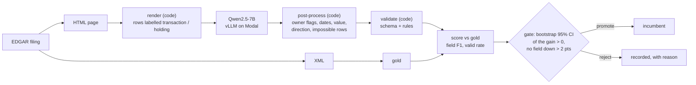

# AutoExtract: SEC Form 4 extraction with a CI-enforced eval gate

[](https://github.com/michael-jw-ji/AutoExtract/actions/workflows/eval.yml)

Extracts insider transactions from real SEC Form 4 filings with a 7B open
model, scores every change against a frozen holdout whose gold comes from each
filing's own XML, and ships a change only if a statistical gate says it is
better.

| On 189 frozen holdout filings (553 transactions) | Field F1 | Schema-valid |
|---|---|---|
| Qwen2.5-7B, first prompt (baseline) | 0.8401 | 54.5% |
| **Qwen2.5-7B, after 5 promoted changes (8 tried)** | **0.9204** | **96.3%** |
| Qwen2.5-32B, same pipeline (reference, not served) | 0.9965 | 100% |

- **What moved it:** fixes in the *right layer*, not the model: owner
  checkboxes read by code (100% from 86%), rows labelled "transaction" or
  "holding" in the rendered page (invented rows 132 → 52 in one change),
  footnote-only prices
  set by code. Two prompt rewrites traded one field for another and were
  rejected. ([FAILURES.md](FAILURES.md), [RESULTS.md](RESULTS.md))
- **A failure a bigger model does not fix:** the 32B turns footnote-only prices
  into `0` three times as often as the 7B, and answers code `V` when a code
  equals its A/D letter. It follows the prompt's rules more literally.
- **What is still wrong:** the 7B leaves out 37 of 553 real rows. The
  baseline missed 4 but invented 208. F1 hides that trade; FAILURES.md does not.
- **Cost:** $0.0012 per filing on a Modal L40S, latency p50 8.3 s / p99 159 s
  (OpenTelemetry traces).
- **Judge:** an LLM judge for officer titles, validated against human labels:
  TPR 0.989, TNR 0.984.

## Run it in 30 seconds (macOS/Linux)

No keys, no downloads, no model: the tests, plus the CI eval replaying 30
recorded model answers through the current code.

```
git clone https://github.com/michael-jw-ji/AutoExtract && cd AutoExtract
make setup
make ci
```

Needs Python 3.11+. On Windows the same works under Git Bash with `make`.

## How it works



- **Gold is free and exact.** Every Form 4 is filed as XML; the page the
  model reads is rendered from that same XML. 44 tricky filings are also
  AI-assisted, human-confirmed labels, with ambiguous fields marked rather
  than forced.
- **Every change is a candidate:** prompt, rendering, post-processing or
  model. It is scored on the frozen holdout and promoted only if the gain is
  statistically real and no field regresses. Rejections are kept as records.
- **Every number is reproducible:** each run's log, trace and recorded model
  answers are committed (`results/runs/`, `data/eval_cache/`), and changes
  after the model are re-scored by replaying those answers, at no cost.

Full walkthrough with diagrams: [docs/HOW_IT_WORKS.md](docs/HOW_IT_WORKS.md).

## CI eval

Every PR runs the unit tests plus `scripts/ci_eval.py`: 30 recorded model
answers replayed through the PR's code. There are no model calls, so it is
free and deterministic, and any score change comes from the code. It fails if
any scored field drops more than 0.5 points, and refuses to score at all if
the prompt or rendered input changed (that needs a live eval).

**Demo:** [PR #2](https://github.com/michael-jw-ji/AutoExtract/pull/2) is a
deliberate regression that looks like a harmless cleanup (round share counts
to whole numbers). All 75 unit tests pass; the eval catches it, because real
filings report fractional holdings:

```
transactions.*.shares              0.9220 -> 0.8865 -3.6  <-- REGRESSION
transactions.*.shares_owned_after  0.9267 -> 0.8933 -3.3  <-- REGRESSION
```

## MCP server

`mcp_server.py` exposes the pipeline to AI agents (Claude Desktop, Claude
Code, Cursor...) over stdio:

| Tool | What it does |
|---|---|
| `extract_form4(url_or_text)` | Extracts one Form 4 with the served pipeline. Given an EDGAR filing URL, it also fetches the filing's XML and reports the field-level F1 and which fields differ, so every answer arrives checked. |
| `get_eval_summary()` | The promoted pipeline's scores on the frozen holdout, every gate decision (promoted and rejected, with reasons), and cost and latency from the latest traced run. |

**Claude Desktop:** add this to `claude_desktop_config.json` (Settings ->
Developer -> Edit Config), with your own paths, then restart Claude Desktop:

```json
{
  "mcpServers": {
    "autoextract-form4": {
      "command": "/path/to/AutoExtract/.venv/bin/python",
      "args": ["/path/to/AutoExtract/mcp_server.py"]
    }
  }
}
```

On Windows the command is `C:/path/to/AutoExtract/.venv/Scripts/python.exe`.
The server reads `.env` from the repo (the model endpoint's `LLM_BASE_URL` /
`LLM_API_KEY`, and `SEC_USER_AGENT` for URLs). Then ask, for example:
*"Extract this Form 4 and tell me if it matches the filing:
https://www.sec.gov/Archives/edgar/data/1969302/000110465926113258/"*.

## Running the full pipeline

Needs a model endpoint (see `infra/modal_small.py` for the 7B on Modal) and a
`SEC_USER_AGENT` with a contact email, both in `.env` (copy `.env.example`).

```
make fetch N=200          # EDGAR filings: HTML (model input) + XML (gold), SEC rate limit respected
make load                 # into form4.db
make label                # review tool for hand labels, http://127.0.0.1:8765
make baseline             # score the served model on the frozen holdout
make candidate NAME=x NOTE="what changed"      # score a change and let the gate decide
make replay NAME=x FROM=<version> NOTE="..."   # same, for changes after the model: no model calls
make failures             # failure reader, http://127.0.0.1:8766
make trace-report T=results/runs/<run>.traces.jsonl
make help                 # everything else
```

## Layout

| Path | Role |
|---|---|
| `domains/` | `form4.py`: schema, rules, prompt, post-processing; `form4_io.py`: XML to gold, HTML to text |
| `serve/` | OpenAI-compatible client (vLLM on Modal), extraction, OpenTelemetry tracing |
| `verify/` | deterministic validation, failure signatures, field-level comparison |
| `evalgate/` | frozen-holdout scorer, bootstrap gate, failure explainer, LLM judge |
| `scripts/` | fetch, load, label, failure reader, cycle driver, CI eval, 32B comparison, reports |
| `infra/` | Modal deployments for the 7B (L40S) and 32B (H100) |
| `mcp_server.py` | the MCP tools |
| `buffer/`, `repair/`, `train/` | the self-improvement loop (failure clustering, verified repairs, LoRA), inherited from the hackathon version |
| `results/runs/`, `data/eval_cache/` | every run's log, numbers, trace and recorded answers |

Started as a Hack the North 2026 self-improving invoice extractor; the design
rules (verified repairs only, frozen holdout, gate) are in [CLAUDE.md](CLAUDE.md).
