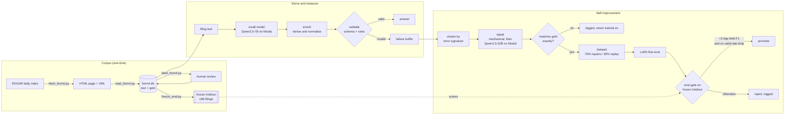
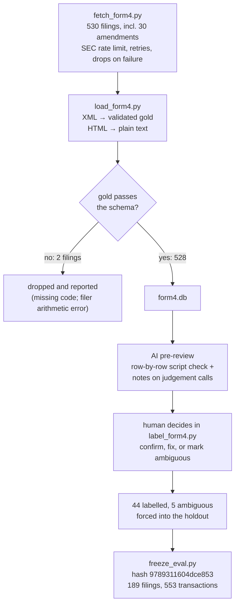
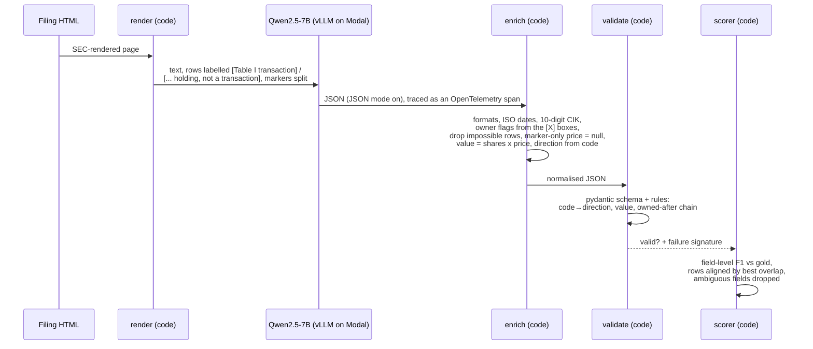

# How AutoExtract works

AutoExtract turns messy documents into strict, validated JSON, measures
exactly where it is wrong, and is built to retrain itself on its own verified
corrections, shipping a new model only if it beats the old one on a frozen
test set.

It started as a Hack the North 2026 project on synthetic invoices. It now runs
on **real SEC Form 4 filings** (insider stock transactions), using each
filing's official XML as an exact answer key.

> Numbers in this document are either **measured** (with the command or data
> behind them) or explicitly marked as **expected**. Results live in
> [RESULTS.md](../RESULTS.md); the roadmap lives in [PLAN.md](PLAN.md).

---

## Contents

1. [Status at a glance](#1-status-at-a-glance)
2. [The problem: why Form 4](#2-the-problem-why-form-4)
3. [System overview](#3-system-overview)
4. [Building the eval set](#4-building-the-eval-set)
5. [One extraction, end to end](#5-one-extraction-end-to-end)
6. [The self-improvement loop](#6-the-self-improvement-loop)
7. [Measurement design](#7-measurement-design)
8. [Bugs found by measuring](#8-bugs-found-by-measuring)
9. [Results and expected results](#9-results-and-expected-results)
10. [Stack](#10-stack)
11. [Repository layout](#11-repository-layout)
12. [Running it](#12-running-it)
13. [Known limitations](#13-known-limitations)

---

## 1. Status at a glance

| Milestone | What | State |
|---|---|---|
| 1. Form 4 domain | fetch filings, XML to gold, schema and rules, labelled frozen holdout, baseline | **done**: field F1 0.8352, valid 54.5% |
| 2. Failure analysis | read failures, write `FAILURES.md`, fix each in the right layer, before/after per field | **done**: F1 0.9204, valid 96.3%; a 32B check |
| 3. CI, tracing, judge | GitHub Actions eval gate, OpenTelemetry cost/latency, LLM judge checked against labels | **done** (see section 9) |
| 4. MCP server, polish | `extract_form4` as an MCP tool, README with results | planned |
| Loop: repair, train, gate | repairs verified against gold, LoRA, promotion gate | **done**: LoRA on 186 verified repairs + 80 replay, F1 0.9204 → 0.9932 (RESULTS.md, Fix 8) |

---

## 2. The problem: why Form 4

When a company insider buys or sells their company's stock, they file a
**Form 4** with the SEC within two business days. A filing says who the
insider is, how they relate to the company (director, officer, 10% owner),
and every transaction: date, transaction code, number of shares, price,
whether shares were acquired or disposed, and how many they hold afterwards.

It is a good extraction benchmark for three reasons:

- **Exact answers for free.** Every filing ships with machine-readable XML.
  The model reads the human-readable page; the XML is the answer key. No
  hand-labelling for the easy fields.
- **Real messiness.** Footnote markers glued to numbers (`2,180,631(5)`),
  two tables (stock vs options and warrants) with different column layouts,
  prices that exist only in footnotes, rows listed newest-first, multiple
  reporting owners, amendments that restate earlier filings.
- **Real stakes.** This data feeds trading signals and compliance tools, so
  being "mostly right" isn't enough.

---

## 3. System overview



Three ideas carry the design:

1. **Code does everything that has a right answer.** The model reads the
   page; code normalises formats, derives values (transaction value =
   shares x price) and fixes direction where the transaction code fixes it.
2. **Validation is deterministic.** No LLM decides what failed. A pydantic
   schema plus explicit business rules produce a failure *signature* such as
   `owned_after_mismatch:transactions.*.shares_owned_after`.
3. **Nothing ships on vibes.** A frozen holdout, a numeric promotion margin,
   and a hard failure if a test document ever leaks into training data.

---

## 4. Building the eval set



**Where the gold comes from.** The XML is the filer's own structured
submission, so it is not generated or guessed. The loader validates every
XML through the same schema and rules the model is held to. A filing whose
own gold breaks them is dropped, never "repaired": one has a transaction
with no code, and one (Alaska Air) reports holdings that contradict its own
arithmetic.

**Why labels at all**, when the XML is exact: the model reads the *page*,
not the XML. Labelling checks that the page actually supports the answer key,
and makes ambiguity explicit where it doesn't. The 5 ambiguous filings
(listed in [RESULTS.md](../RESULTS.md)) include a filing whose checkboxes
contradict its own remarks about who is a director.

**How the labels were made.** A script compared every transaction row on
the page to the gold, field by field (296 rows across 40 filings, zero
disagreements). It was first tested against six kinds of planted errors and
caught all of them. An AI pre-review wrote notes on the judgement calls, and a
human made each decision. Label files record `assisted_by`, so these are
"AI-assisted, human-confirmed".

**The freeze.** `freeze_eval.py` stores a hash of the holdout's document
IDs. Scoring refuses to run on an unfrozen holdout, text re-rendering refuses
to touch a frozen one, and `build_dataset()` hard-fails if any holdout
document appears in training data.

---

## 5. One extraction, end to end



**The input** is the SEC-rendered page converted to plain text at serve
time (render v3), one table row per line, each data row labelled by what the
form's own columns say it is. An excerpt from a real filing (United
Therapeutics, an option exercise followed by sales, plus holdings):

```
Issuer CIK: 0001082554
[X] Director | [ ] 10% Owner
[X] Officer (give title below) | [ ] Other (specify below)
[Table I transaction] Common Stock | 10/08/2026 | M (1) | 9,500 | A | $117.76 | 333,943 | I | by Trust (2)
[Table I transaction] Common Stock | 10/08/2026 | S (1) | 200 | D | $525.4958 (3) | 333,743 | I | by Trust (2)
[Table I holding, not a transaction] Common Stock | 166 | I | by Spouse
[Table II transaction] Stock Option | $117.76 | 10/08/2026 | M (1) | 9,500 (D) | (21) | 03/15/2027 | Common Stock | 9,500 | $0.00 | 271,410 | I | by Trust (22)
```

The `(1)`, `(3)` and so on are footnote markers. Footnote 3 here says $536.2579
is a weighted average of trades between $535.88 and $536.57.

**The output schema** (`domains/form4.py`):

| Field | Notes |
|---|---|
| `issuer_cik`, `issuer_name`, `issuer_ticker`, `period_of_report` | CIK is 10 digits; dates ISO |
| `reporting_owners[]` | `name`, `is_director`, `is_officer`, `is_ten_percent_owner`, `officer_title`; a list, because 9% of filings have several owners |
| `transactions[]` | `security_title`, `is_derivative` (Table II), `date`, `code` (one of 20 SEC codes), `shares` > 0, `price_per_share` >= 0 or null, `acquired_disposed` A/D, `shares_owned_after`, `direct_or_indirect` D/I, `value` (derived, not scored) |

**The rules**, each checked against real gold before being adopted:

| Rule | Evidence |
|---|---|
| Direction follows the code: P, A, M-in-Table-I acquire; S, D, F, M-in-Table-II dispose | 454 of 454 real transactions |
| Same-day direct rows chain: owned-after = neighbour's owned-after ± shares | the first version broke on a filer who lists rows newest-first; now either order is accepted, and a genuinely inconsistent filing still fails |
| `value` = shares x price | derived by code, so a mismatch means a tampered value |

---

## 6. The self-improvement loop

Inherited from the invoice version and domain-agnostic. **It has not been run
on Form 4 yet**; that is Milestone 2 onward.

| Stage | What happens | Guard |
|---|---|---|
| Serve | extract live documents, append every result to the DB | failures go to a buffer, nothing is dropped |
| Cluster | group failures by their deterministic signature | no embeddings; a signature is human-readable |
| Repair | mechanical fixes first, then Qwen2.5-32B with the schema, rules and reference notes | the repairer sees the filing, the failed attempt and the exact errors |
| Verify | a repair counts only if it is schema-valid **and** matches gold exactly | a self-consistent but wrong repair would teach the model to be confidently wrong, so unverified repairs are never trained on |
| Dataset | 70% verified repairs, 30% replay of previously-correct examples | no single failure signature above 25% of the repair half; holdout leak = hard failure |
| Train | LoRA fine-tune | local GPU or Baseten (see limitations) |
| Gate | score the candidate on the frozen holdout | promote only at **+2.0pp field F1** with no valid-rate regression; rejections are recorded |

---

## 7. Measurement design

**Field-level F1, not pass/fail.** A filing with 20 rows and one wrong price
is not "wrong". Every non-empty leaf is a unit, including each cell of each
row. Pass/fail on ~190 documents is too coarse to tell a real improvement from
noise.

**Rows aligned by best overlap.** Predicted rows are paired with gold rows by
how many fields agree, not by position. A model that skips row 2 is penalised
for row 2, not for every row after it.

**Per-field accuracy** is reported for fields inside rows, such as
`transactions.*.price_per_share`, so failures can be attributed precisely.

**Normalisation that fixes comparison, never answers.** Numbers compare as
numbers (`12.50` = `"12.5"` = `"$12.50"`); whitespace is collapsed. A wrong
number is still wrong.

**Ambiguity is excluded, not guessed.** Fields a human marked ambiguous are
removed from both the prediction and the gold before scoring.

---

## 8. Bugs found by measuring

Each of these would have shown up as "model error" and been wrong.

| Bug | How it was found | Fix |
|---|---|---|
| Issuer CIK isn't on the rendered page | reading a raw model output: the model was inventing CIKs | an `Issuer CIK:` line from EDGAR metadata starts each document |
| Checkboxes rendered as `Director \| X \| 10% Owner` (the X belongs to 10% Owner) | the human labeller asked whether an owner was a director | render `[ ] Director \| [X] 10% Owner`; verified against the XML on all 530 filings |
| Table II acquired/disposed lost (shown by column, not letter) | the labeller couldn't tell a direction from the text | render `100,000 (D)`; verified on all 294 derivative transactions |
| XML double-spaces titles (`Class A  Common Stock`) | automated "is every gold value on the page" check | scorer collapses whitespace (affected 7% of titles) |
| Ollama context silently 4,096 tokens | measuring prompt tokens on the longest filing | 16K-context variant for local runs; the Modal server is sized to 16K |
| Output caps sized for invoices | sizing the worst real answer and repair prompt | extraction and repair outputs 8,192; repairer sees 12,000 chars of attempt; Modal context 20,480. The worst repair prompt was measured at 9,935 tokens and accepted |
| Baseline would have run on a different model than training | planning hosted training: Ollama's 7B is a 4-bit build, training uses the full-precision weights | small model moved to Modal; local numbers are never reported |
| Scorer sent 10 requests to a one-at-a-time server | the first baseline stalled: 69 of 129 requests timed out in the queue | concurrency matches the server, answers cached as they arrive, resumable, refuses to score missing answers |
| Shared code fell back to the invoice schema on error | removing the invoice domain | fallbacks removed; a broken domain fails loudly |
| Duplicate filings in the fetch | load count was 201 from 200 files | EDGAR lists a filing once per filer; dedupe by accession |

---

## 9. Results and expected results

### Measured

| | |
|---|---|
| Filings fetched | 530 (500 Form 4 + 30 amendments) |
| Loaded | 528 (2 dropped: their own XML breaks the rules) |
| Frozen holdout | 189 filings, 553 transactions, hash `9789311604dce853` |
| Live (for the loop) | 339 filings |
| Labelled | 44 human-confirmed (AI-assisted), 5 with ambiguous fields |
| Baseline | field F1 **0.8352**, valid rate **54.5%** (Qwen2.5-7B, bf16); details in [RESULTS.md](../RESULTS.md) |

**Early signal, not a result.** A 20-document probe, run before the text
rendering fixes, failed validation on 85% of documents with `qwen2.5:3b` (it
mostly stopped after four fields) and 25% with `qwen2.5:7b`. That is why the
7B serves. The real baseline will replace this.

### After Milestone 2 (all in [RESULTS.md](../RESULTS.md))

| Version | Change | Field F1 | Valid | Gate |
|---|---|---|---|---|
| base | prompt v1 | 0.8401 | 54.5% | baseline |
| prompt-v2 | prompt from FAILURES.md | 0.8614 | 80.4% | promoted (old margin rule) |
| prompt-v3 | "report every row" | 0.8736 | 76.7% | rejected (old margin rule) |
| code-fixes-1 | owner flags from the page, `/K`, impossible rows | 0.8716 | 84.1% | promoted |
| render-v2 | table labels, marker split | 0.8721 | 83.6% | rejected |
| render-v3 | rows labelled transaction / holding | 0.9182 | 96.3% | promoted |
| enrich-v3 | markers stripped from titles | 0.9194 | 96.3% | promoted |
| enrich-v4 | marker-only price cell = null | **0.9204** | **96.3%** | promoted |

What the early hypotheses got right and wrong: holdings rows and Table II
confusion were fixed in the RENDERING, not the prompt (two prompt revisions
traded fields; one rendering change removed 55 of 59 holdings rows). The
footnote-only price was predicted to defeat a bigger model, and it did, but
not as predicted: the 32B makes it worse, by applying the prompt's "$0 means
0" literally. The remaining weakness is rows the 7B leaves out (37 of 553),
which prompt v2 caused: see FAILURES.md, "Where each cause stands".

### Milestone 3

- **CI eval:** every PR replays 30 recorded answers through its code, with no
  model calls, and fails on any field drop over 0.5 points.
  [PR #2](https://github.com/michael-jw-ji/AutoExtract/pull/2) shows it catching
  a regression that all unit tests pass.
- **Tracing:** OpenTelemetry spans per model call. The 7B costs **$0.0012 per
  filing**, with latency **p50 8.3 s and p99 158.7 s**.
- **LLM judge** for officer titles (Qwen2.5-32B): **TPR 0.989, TNR 0.984** on
  217 items with human-confirmed truth. Exact match in code scores 0.0 on
  titles stated in the Remarks and on abbreviations.
- **Prompt v4** (the code may equal its A/D letter) was better on every row
  measure but rejected: the F1 interval [-0.14, +4.07] includes zero.

---

## 10. Stack

| Part | What | Why |
|---|---|---|
| Small model | Qwen2.5-7B-Instruct, bf16, vLLM on a Modal L40S (`infra/modal_small.py`), LoRA enabled | the same weights hosted training fine-tunes, so before/after compare one model; about $1.95/hour while up. Local Ollama is kept for free experiments only |
| Large model | Qwen2.5-32B-Instruct, bf16, vLLM on a Modal H100 (`infra/modal_llm.py`) | repairs need a clearly stronger model; scales to zero, about $3.95/hour while up |
| Client | OpenAI SDK against any OpenAI-compatible URL; small and large routed separately | swap providers with `.env` only |
| Validation | pydantic v2, custom rule errors with field locations | deterministic, readable failure signatures |
| Storage | SQLite (`form4.db`), append-only by stage | the audit trail survives a crash |
| Data | SEC EDGAR daily indexes, filing XML and rendered HTML (`httpx`) | public, exact gold |
| Labelling | FastAPI + one-page HTML tool, local only | review beside the page |
| API / dashboard | FastAPI, Next.js | from the invoice version; not yet updated for Form 4 |
| Training | TRL/PEFT LoRA locally, or Baseten training | see limitations |
| Tests | pytest, 46 tests, no network or model needed | |

---

## 11. Repository layout

```
domains/form4.py        schema, rules, enrichment, prompts for Form 4
domains/form4_io.py     XML → gold, HTML → text, difficulty tags
scripts/fetch_form4.py  download filings from EDGAR
scripts/load_form4.py   validate gold, render text, load into form4.db, apply labels
scripts/label_form4.py  review tool (http://127.0.0.1:8765)
scripts/freeze_eval.py  freeze the holdout
scripts/probe.py        quick failure-rate check
scripts/run_cycle.py    the loop: baseline, serve, repair, train, evaluate
serve/                  model client and extraction
verify/                 validation, signatures, field-level comparison
buffer/ repair/ train/ evalgate/   the self-improvement loop
infra/                  Modal endpoint, Ollama model file
data/form4/labels/      human labels (tracked)
data/form4/review/      AI pre-review notes (tracked)
RESULTS.md              frozen holdout and every measured number
docs/PLAN.md            roadmap and checklists
```

---

## 12. Running it

```
python -m venv .venv && .venv\Scripts\activate      # macOS/Linux: source .venv/bin/activate
pip install -e ".[dev,infra]"
cp .env.example .env                                 # SEC_USER_AGENT, model settings
modal deploy infra/modal_small.py                    # small model; set LLM_* in .env
pytest

python scripts/fetch_form4.py --n 200                # needs SEC_USER_AGENT
python scripts/load_form4.py
python scripts/label_form4.py                        # optional: review and label
python scripts/freeze_eval.py
python scripts/run_cycle.py --stage baseline --domain form4
```

The large model is only needed for repairs:
`modal deploy infra/modal_llm.py`, then set `LARGE_LLM_*` in `.env`.

---

## 13. Known limitations

- **Training is not settled for the 7B.** A 7B LoRA does not fit in 8 GB, and
  Baseten training returns 403 on this workspace. The options are training a
  smaller model locally (which makes the before/after a different model from
  the one serving) or hosted training.
- **The API and dashboard** still carry invoice-era assumptions (for example,
  which fields count as "business rules").
- **`train/dataset.py`'s negative-control dataset** is invoice-specific and
  needs a Form 4 equivalent.
- **Missed rows (before the LoRA).** The prompt-only 7B left out 37 of 553
  real transactions (the baseline missed 4, while inventing 208); the LoRA
  misses 6 and invents none.
- **One corpus window.** All filings were filed between late September and
  early October 2026; seasonal filing patterns are not covered.
